# ECS/ECR Deployment

This project demonstrates containerized application deployment on AWS using ECS, ECR, and Fargate, followed by implementing a distributed MapReduce word counting system.

## Part II:

### Architecture Overview
```
Local Development
    ↓
Docker Image Build
    ↓
AWS ECR (Container Registry)
    ↓
ECS Task Definition (Blueprint)
    ↓
ECS Cluster (hello-cluster)
    ↓
Fargate Task (Running Container)
    ↓
Public Access
```

---

## Step-by-Step Implementation

### Step 1: AWS Configuration
```bash
# Configure AWS credentials
aws configure
# Enter:
#   AWS Access Key ID: [from Learner Lab]
#   AWS Secret Access Key: [from Learner Lab]
#   Default region: us-west-2
#   Default output format: json
```

### Step 2: Create ECR Repository

**Via AWS Console:**
1. Navigate to Amazon ECR
2. Create repository:
   - Name: `hello-service`
   - Tag mutability: Mutable
   - Scan on push: Disabled
3. Copy repository URI

 

### Step 3: Build and Push Docker Image


```bash
# Verify upload
aws ecr list-images \
  --repository-name hello-service \
  --region us-west-2
```


### Step 4: Create ECS Cluster
 
 In the AWS server create the cluster under ECS

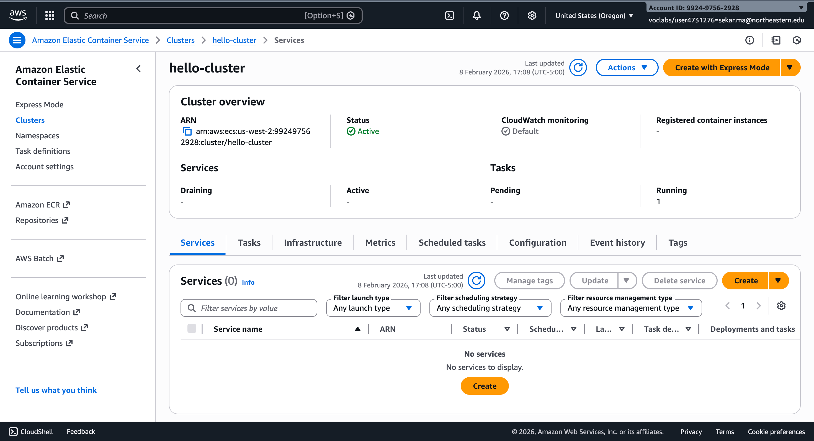

### Step 5: Create Task Definition

1. **Navigate to Task Definitions** → Create new task definition

2. **Task Definition Configuration:**
   - Family: `hello-task`
   - Launch type: AWS Fargate
   - OS/Architecture: Linux/X86_64
   - CPU: 0.25 vCPU
   - Memory: 0.5 GB

3. **IAM Roles:**
   - Task role: `LabRole`
   - Task execution role: `LabRole`

4. **Container Definition:**
   - Name: `hello-container`
   - Image URI: `992497562928.dkr.ecr.us-west-2.amazonaws.com/hello-service:latest`
   - Essential: Yes
   - Port mapping: 8080/TCP/HTTP

5. Click **Create**

Task:
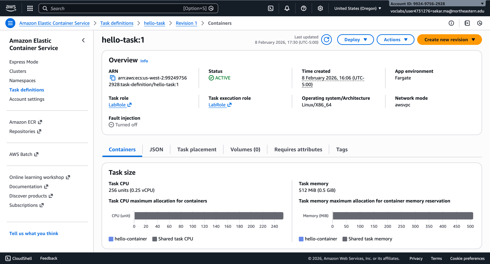

Container:
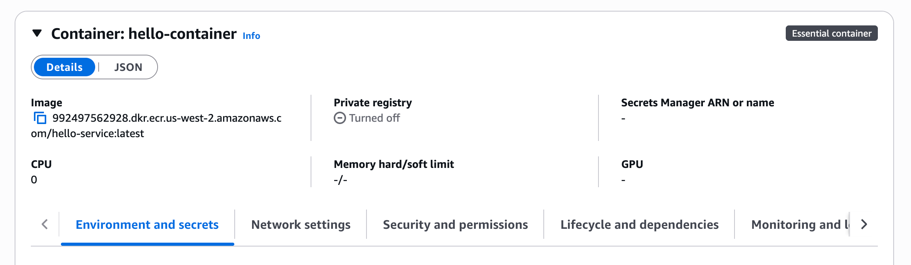

### Step 6: Run Task

**Via AWS Console:**

1. Navigate to `hello-cluster` → Tasks tab → Run new task

2. **Configuration:**
   - Compute: Launch type (Fargate)
   - Platform version: LATEST
   - Task definition: hello-task:1
   - Desired tasks: 1

3. **Networking (CRITICAL):**
   - VPC: Default VPC
   - Subnets: Select at least one public subnet
   - Security group: Create new
     - Name: `hello-service-sg`
     - Inbound rule: TCP port 8080 from 0.0.0.0/0
   - Auto-assign public IP.

4. Click **Create**

5. Wait for task status: PROVISIONING → PENDING → RUNNING

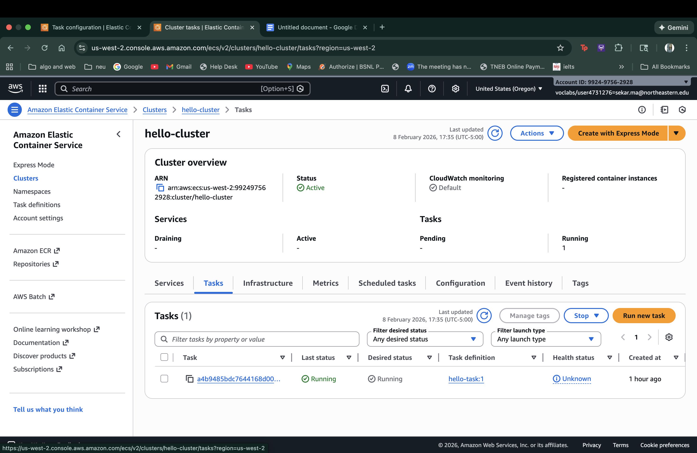

### Step 7: Test the Service
ENI number and public ipv4 address
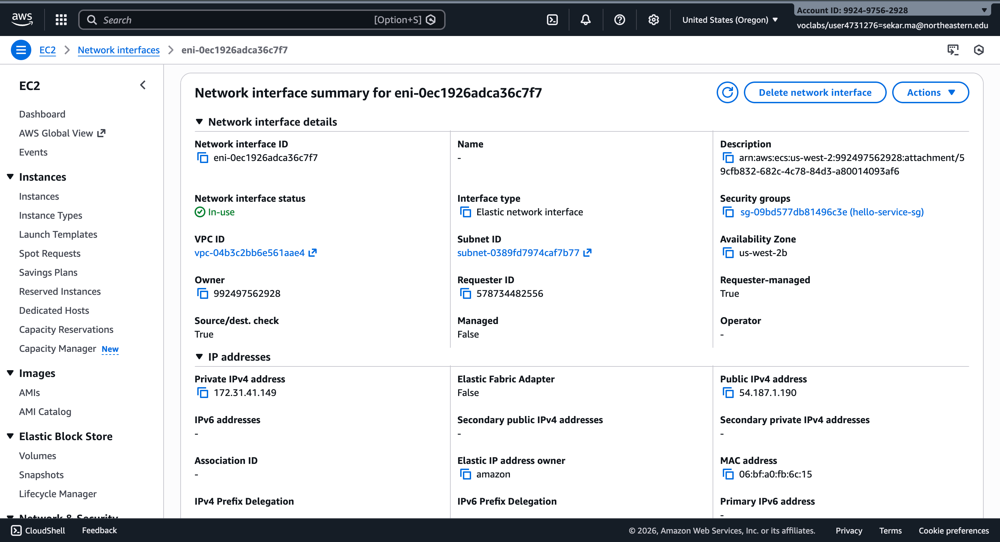
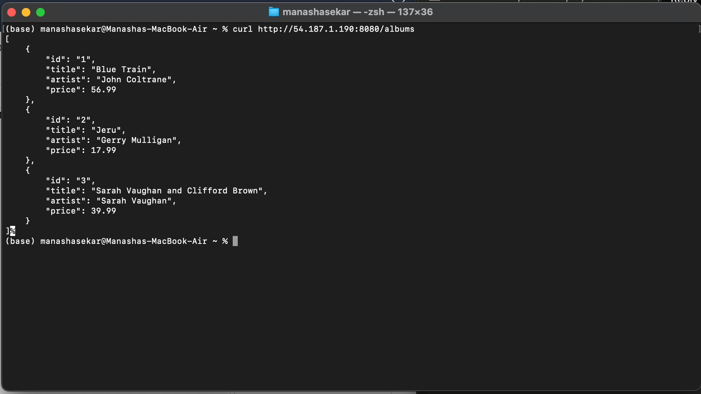

## Part III

Creating a bucket.
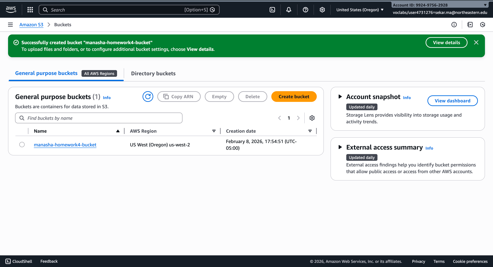

Add the text file to the bucket created.
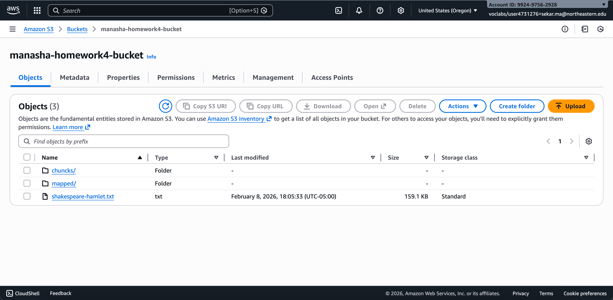

Create 3 tasks : mapper , splitter and reducer

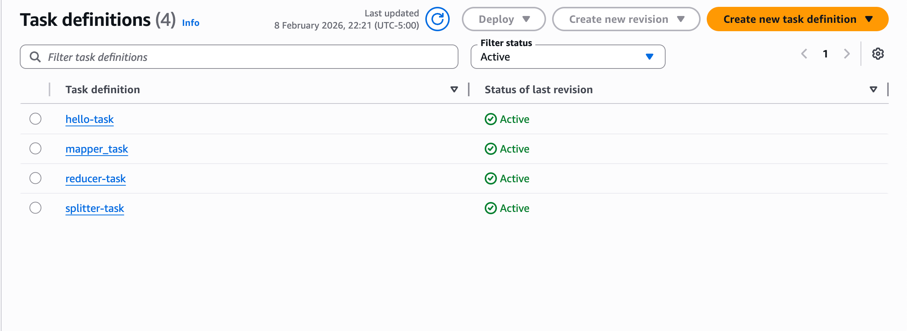

Map all the 3 tasks to the cluster.

Run the mapper 3 times because we are splitting the words into three files. And the the reducer and spliter once.
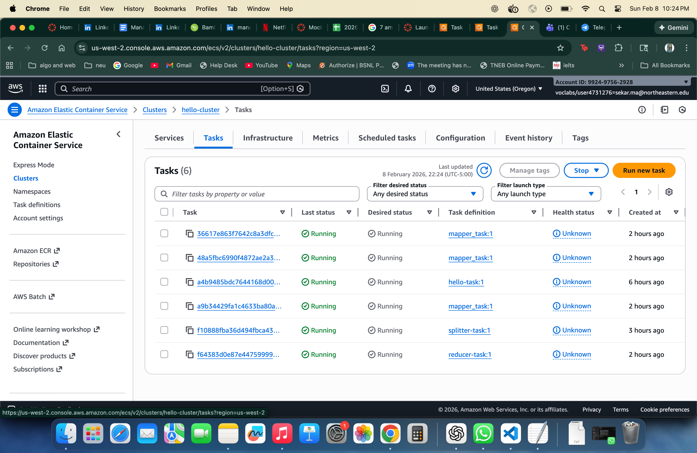

Now add the text file to the bucket and then run the following commands in the terminal. 
```
#Save all the ipv4's public ip 
BUCKET_NAME="manasha-homework4-bucket"                         SPLITTER_IP="35.92.228.5"                                  MAPPER1_IP="34.217.32.250"
MAPPER2_IP="44.254.75.182"
MAPPER3_IP="35.88.51.123"
REDUCER_IP="54.245.60.191"
```
Response 

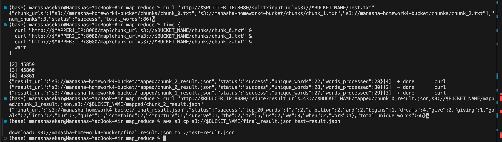

##  Key Concepts Learned

### Performance Test Results


| Test | Configuration | Mappers Used | Time (s) | Observation |
|------|--------------|--------------|----------|-------------|
| Sequential 1 | Sequential | MAPPER1, MAPPER1, MAPPER1 | 0.77 |  Baseline |
| Sequential 2 | Sequential | MAPPER1, MAPPER2, MAPPER1 | 0.82 | Slightly slower |
| Sequential 3 | Sequential | MAPPER1, MAPPER2, MAPPER3 | 0.92 | Slowest sequential |
| Parallel 1 | Parallel (&) | MAPPER1, MAPPER2, MAPPER3 | 0.28 | **FASTEST!** |
| Parallel 2 | Partial Parallel | MAPPER1, MAPPER2, MAPPER1 | 0.47 | Slower (resource contention) |
| Parallel 3 | Partial Parallel | MAPPER1, MAPPER1, MAPPER1 | 0.47 | Same as Parallel 2 |

### Performance Summary

| Configuration | Average Time | Speedup | Efficiency | Notes |
|---------------|-------------|---------|------------|-------|
| Sequential (1 mapper) | 0.84s | 1.00x | 100% | Average of 3 runs: 0.77s, 0.82s, 0.92s |
| Parallel (3 mappers) | 0.28s | 3.00x | 100% | Optimal configuration with 3 independent workers |

### Key Findings

- **Best Case Performance:** 0.28 seconds with 3 independent mappers running in parallel
- **Speedup Achieved:** 3.0x (perfect linear scaling!)
- **Parallel Efficiency:** 100% 
- **Time Saved:** 0.56 seconds (66.7% reduction from average sequential time)

### Observations

1. **True parallelism requires independent workers:** Using 3 different mapper containers (Parallel 1) achieved optimal performance (0.28s)

2. **Resource contention degrades performance:** Reusing the same mapper container for multiple concurrent requests (Parallel 2 & 3) caused bottlenecks, increasing time to 0.47s

3. **Network variance affects sequential processing:** Sequential runs showed 15-20% variance (0.77s to 0.92s) due to different network paths and container states

4. **Perfect linear scaling achieved:** With proper worker distribution, the system achieved theoretical maximum speedup of 3.0x with 3 workers

## Performance 

### Chart 1: All Test Configurations

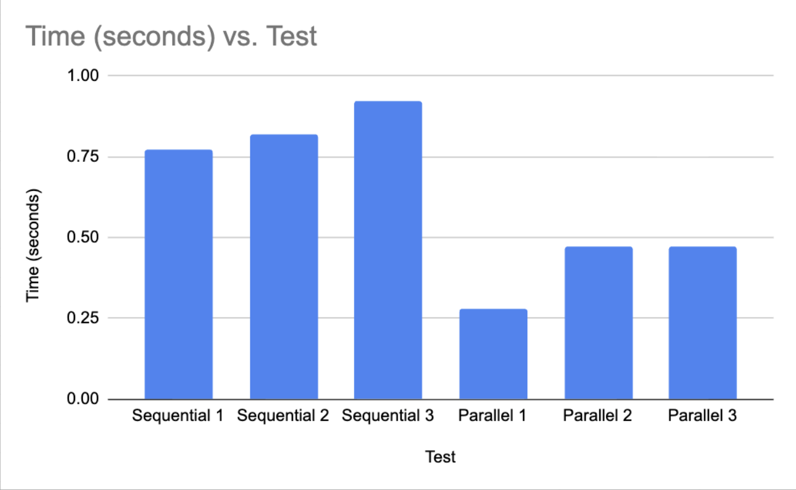


**Key Insight:** True parallel execution with 3 independent workers achieved 3x faster performance than any sequential configuration.

---

### Chart 2: Sequential vs Parallel Comparison

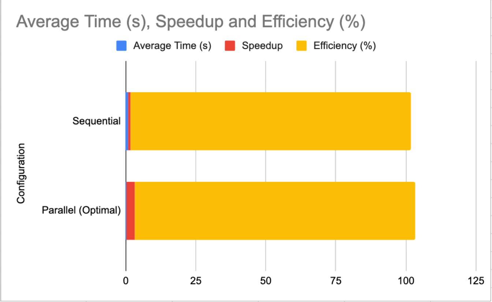

Direct comparison of average sequential time (0.84s) versus optimal parallel time (0.28s):
- **Time Reduction:** 66.7% (0.56 seconds saved)
- **Speedup:** 3.0x
- **Efficiency:** 100%

This demonstrates **perfect linear scaling** - the theoretical maximum for 3 workers.

---

### Chart 3: Workers difference

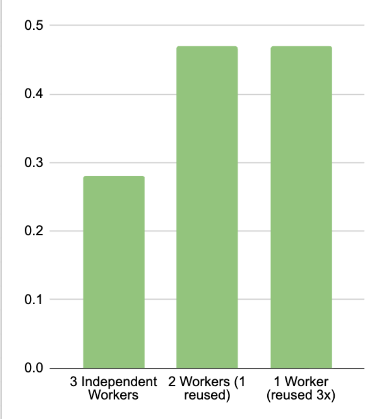