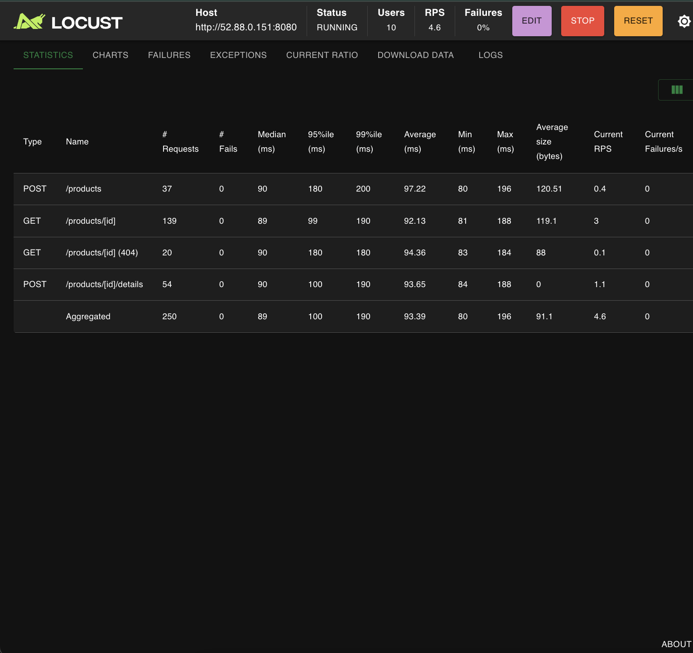
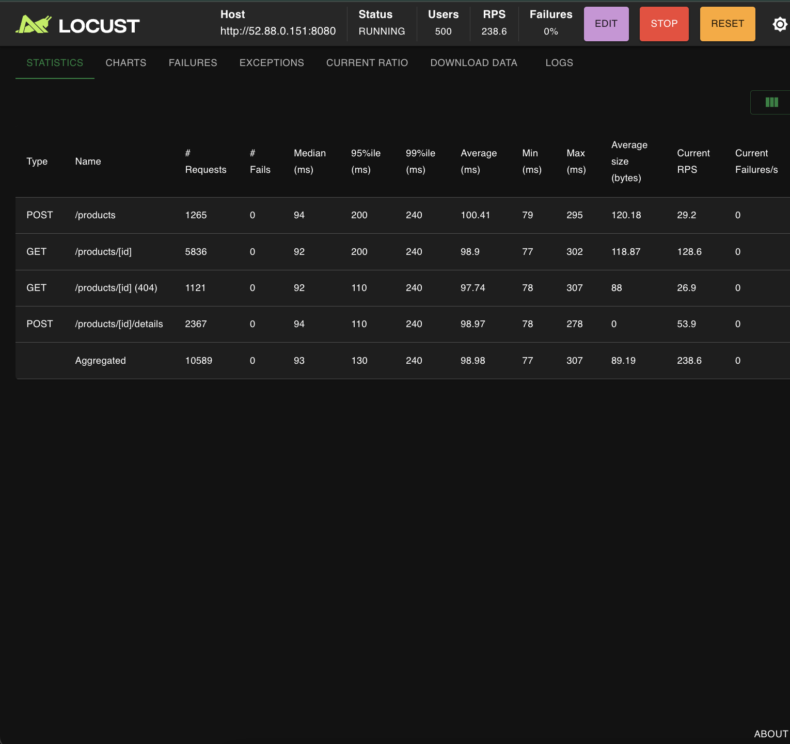
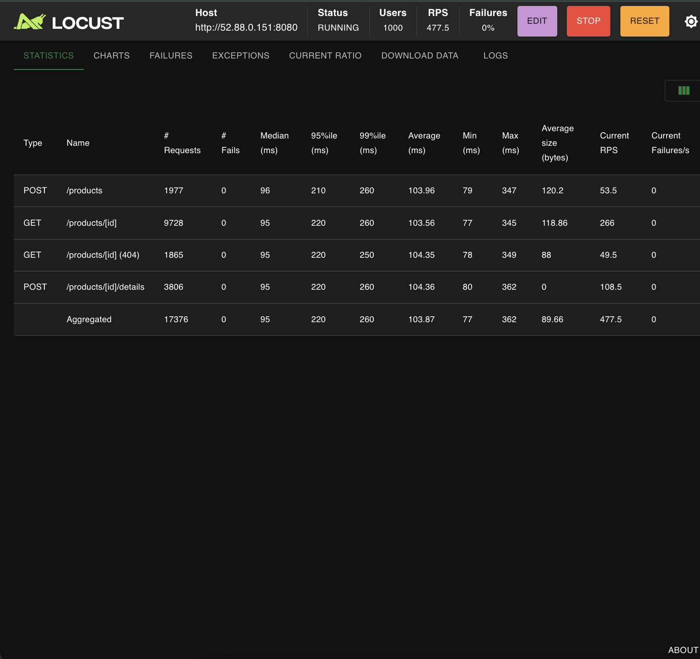
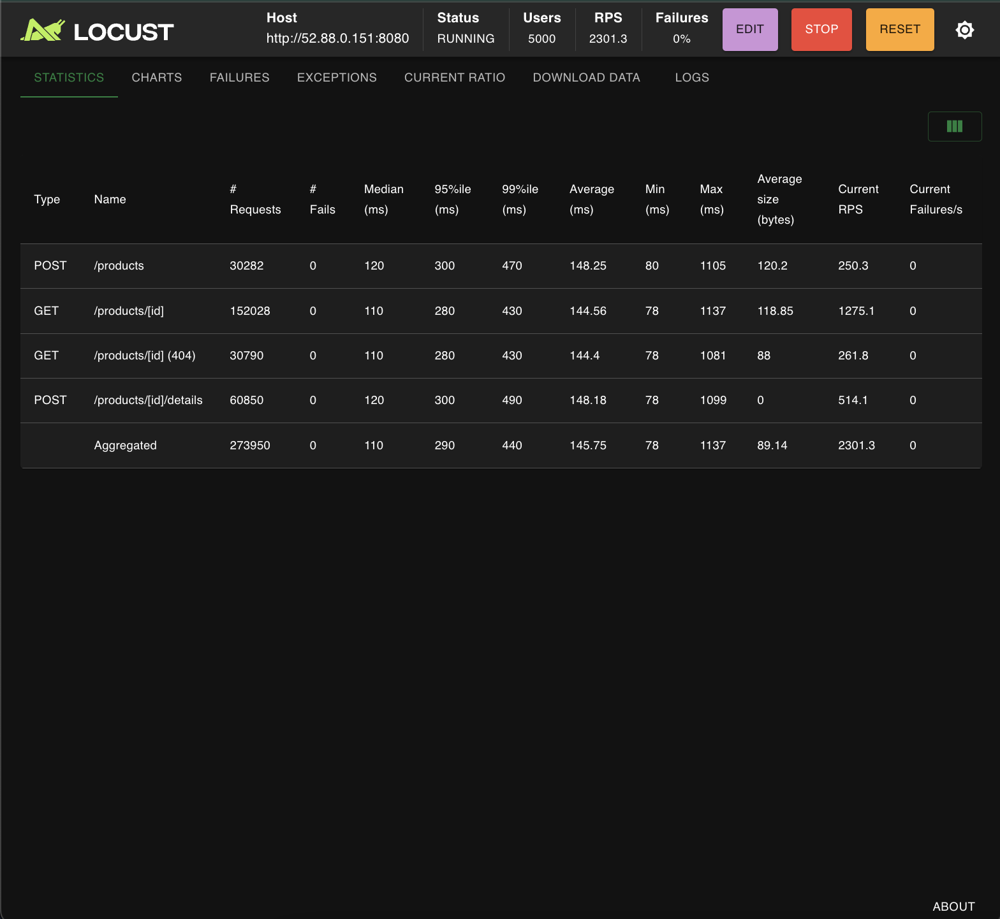
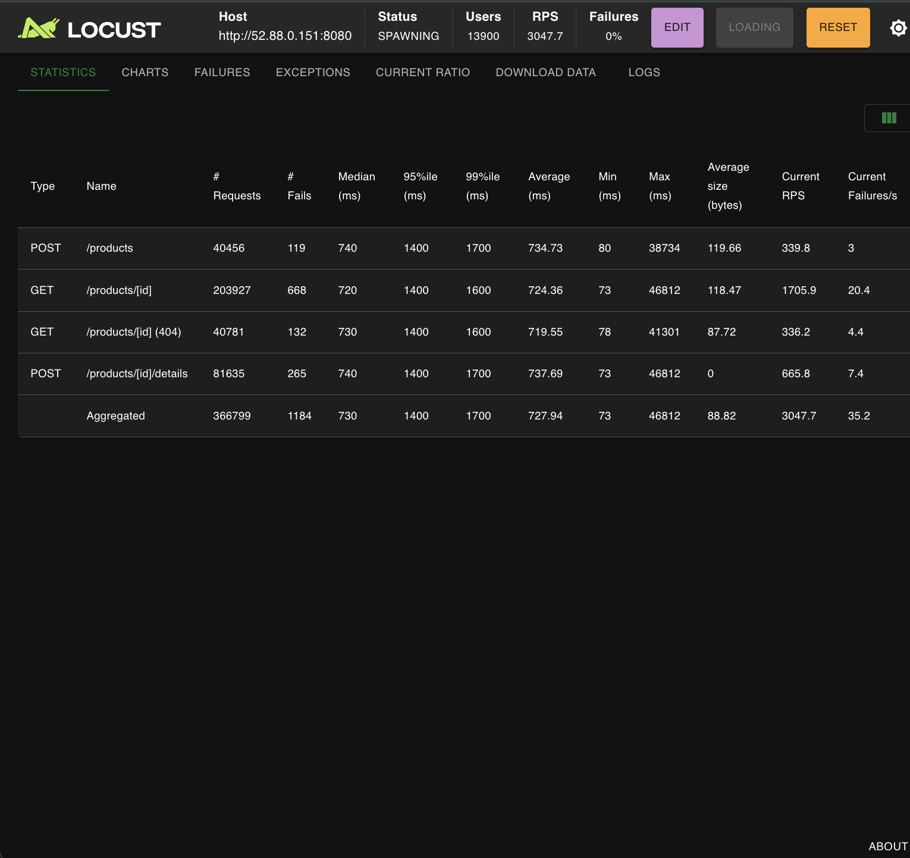
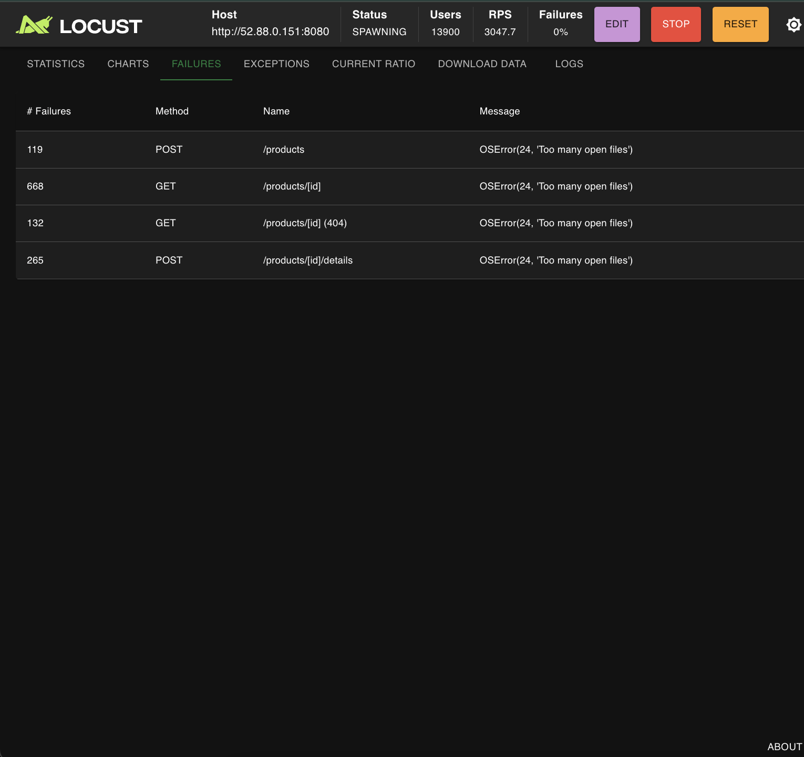

# Report

## Project Overview
A RESTful Product API for a simple e-commerce system, built with Go and the Gin framework. Products are stored in memory using a hashmap. The server is containerized with Docker and deployed to AWS ECS/Fargate using Terraform for infrastructure-as-code.

## Deployment Instructions

### 1. Configure AWS Credentials
```bash
aws configure
```

### 2. Deploy Infrastructure
```bash
cd terraform
terraform init
terraform apply -auto-approve
```

### 3. Get the Public IP
```bash
aws ec2 describe-network-interfaces \
--network-interface-ids $(
    aws ecs describe-tasks \
    --cluster $(terraform output -raw ecs_cluster_name) \
    --tasks $(
        aws ecs list-tasks \
        --cluster $(terraform output -raw ecs_cluster_name) \
        --service-name $(terraform output -raw ecs_service_name) \
        --query 'taskArns[0]' --output text
    ) \
    --query "tasks[0].attachments[0].details[?name=='networkInterfaceId'].value" \
    --output text
) \
--query 'NetworkInterfaces[0].Association.PublicIp' \
--output text
```

### 4. Clean Up
```bash
terraform destroy -auto-approve
```

## Running Locally
```bash
cd src
go run .
# Server starts on http://localhost:8080
```

## API Endpoints & Response Codes

### POST /products — Create a Product (201 Created)
```bash
curl -X POST http://localhost:8080/products -H "Content-Type: application/json" \
  -d '{"product_id":1,"sku":"ABC-123","manufacturer":"Acme Corp","category_id":10,"weight":500,"some_other_id":42}'
```
```json
{"product_id":1,"sku":"ABC-123","manufacturer":"Acme Corp","category_id":10,"weight":500,"some_other_id":42}
```

### GET /products/{productId} — Get Product (200 OK)
```bash
curl http://localhost:8080/products/1
```
```json
{"product_id":1,"sku":"ABC-123","manufacturer":"Acme Corp","category_id":10,"weight":500,"some_other_id":42}
```

### POST /products/{productId}/details — Update Product (204 No Content)
```bash
curl -X POST http://localhost:8080/products/1/details -H "Content-Type: application/json" \
  -d '{"product_id":1,"sku":"UPDATED","manufacturer":"New Corp","category_id":20,"weight":600,"some_other_id":42}'
```

### GET /products/{productId} — Not Found (404)
```bash
curl http://localhost:8080/products/500
```
```json
{"error":"NOT_FOUND","message":"Product not found","details":"No product with ID 999"}
```

### POST /products — Invalid Input (400)
```bash
curl -X POST http://localhost:8080/products -H "Content-Type: application/json" \
  -d '{"product_id":-1,"sku":"","manufacturer":"","category_id":0,"weight":-5,"some_other_id":0}'
```
```json
{"error":"INVALID_INPUT","message":"product_id must be a positive integer"}
```

### POST /products — Duplicate Product (400)
```bash
curl -X POST http://localhost:8080/products -H "Content-Type: application/json" \
  -d '{"product_id":1,"sku":"ABC-123","manufacturer":"Acme Corp","category_id":10,"weight":500,"some_other_id":42}'
```
```json
{"error":"DUPLICATE","message":"Product already exists","details":"Product with ID 1 already exists"}
```
## Load Testing Results

### wait(1,3) - Local Environment

| Users | RPS   | Total Requests | Median (ms) | 95%ile (ms) | 99%ile (ms) | Avg (ms) | Max (ms) | Failures |
|-------|-------|----------------|-------------|-------------|-------------|----------|----------|----------|
| 10    | 5.1   | 539            | 3           | 4           | 6           | 2.68     | 44       | 0%       |
| 100   | 49.6  | 18,606         | 2           | 5           | 12          | 2.63     | 192      | 0%       |
| 500   | 251.1 | 35,595         | 2           | 12          | 34          | 4.15     | 148      | 0%       |
| 1000  | 499.2 | 63,037         | 1           | 22          | 83          | 6.15     | 224      | 0%       |

/10-2stats.png)

/100-10stats.png)

/500-50stats.png)

/1000-100stats.png)

### FastHttpUser (no wait) - Local Environment

| Users | RPS  | Total Requests | Median (ms) | 95%ile (ms) | 99%ile (ms) | Avg (ms) | Max (ms) | Failures |
|-------|------|----------------|-------------|-------------|-------------|----------|----------|----------|
| 10    | 4.6  | 467            | 1           | 4           | 13          | 1.55     | 38       | 0%       |


/fast10-2stats.png)


### wait(0) - No Wait Between Requests - Local Environment

| Users | RPS     | Total Requests | Median (ms) | 95%ile (ms) | 99%ile (ms) | Avg (ms) | Max (ms) | Failures |
|-------|---------|----------------|-------------|-------------|-------------|----------|----------|----------|
| 10    | 4243    | 336,716        | 1           | 2           | 3           | 1.41     | 137      | 0%       |
| 100   | 5157.4  | 560,329        | 13          | 19          | 30          | 13.19    | 80       | 0%       |
| 500   | 4782.6  | 354,262        | 14          | 23          | 37          | 14.99    | 571      | 0%       |
| 1000  | 4577.3  | 294,916        | 14          | 34          | 62          | 20.34    | 4297     | 0%       |

/10-2stats.png)

/100-10stats.png)

/500-50stats.png)

/1000-100stats.png)

### FastHttpUser - Local Environment

| Users | RPS      | Total Requests | Median (ms) | 95%ile (ms) | 99%ile (ms) | Avg (ms) | Max (ms) | Failures |
|-------|----------|----------------|-------------|-------------|-------------|----------|----------|----------|
| 10    | 18742.4  | 739,446        | 0.04        | 1           | 1           | 0.29     | 74       | 0%       |
| 100   | 17186.5  | 963,692        | 2           | 5           | 9           | 2.73     | 593      | 0%       |
| 500   | 17290.5  | 735,967        | 3           | 7           | 13          | 3.49     | 1453     | 0%       |
| 1000  | 7749.7   | 1,365,351      | 3           | 8           | 19          | 4.55     | 1042     | 0%       |


/fast10-2stats.png)

/fast100-10stats.png)

/fast500-50stats.png)

/fast1000-100stats.png)

### AWS ECS Deployment (wait 1,3)

| Users | RPS     | Total Requests | Median (ms) | 95%ile (ms) | 99%ile (ms) | Avg (ms)  | Max (ms) | Failures |
|-------|---------|----------------|-------------|-------------|-------------|-----------|----------|----------|
| 10    | 4.6     | 250            | 89          | 100         | 190         | 93.39     | 196      | 0%       |
| 500   | 238.6   | 10,589         | 93          | 130         | 240         | 98.98     | 307      | 0%       |
| 1000  | 477.5   | 17,376         | 95          | 220         | 260         | 103.87    | 362      | 0%       |
| 5000  | 2301.3  | 273,950        | 110         | 290         | 440         | 145.75    | 1137     | 0%       |
| 10000 | 3099.5  | 224,113        | 1000        | 3000        | 3800        | 1172.12   | 6747     | 0%       |

**Note:** At ~13,900 users, the AWS deployment experienced system resource exhaustion (`OSError(24, 'Too many open files')`) with 1,184 failures. The 10,000 user test shows degraded performance with 1-second median latency, indicating the system approaching its limits.













## Load Testing Summary

### Performance Characteristics

**Local Environment:**
- **wait(1,3)**: Simulates realistic user behavior with 1-3 second think time between requests
  - Achieves ~500 RPS at 1,000 concurrent users with sub-10ms latency
  - Demonstrates excellent linear scaling (10 users → 1,000 users = ~100x RPS increase)
  - Zero failures across all load levels

- **wait(0)**: Maximum throughput test with no delays
  - Peaks at ~5,000 RPS with median latencies under 15ms
  - Bottleneck shifts from server to HTTP client overhead
  - Latency increases modestly under sustained load (1.41ms → 20.34ms at 1K users)

- **FastHttpUser**: Optimized HTTP client demonstrating true server capacity
  - Achieves **18,742 RPS** at just 10 users (0.29ms avg latency!)
  - Proves the Go service can handle extreme throughput when client overhead is minimized
  - 3-4x faster than standard HttpUser under identical conditions

**AWS ECS Deployment:**
- **Baseline latency**: ~90ms due to network round-trip time (vs <3ms locally)
- **Sweet spot**: 500-5,000 users, maintaining 240-2,300 RPS with acceptable latency (<150ms avg)
- **Performance degradation**: Begins at 10,000 users (1,172ms avg latency)
- **Resource limits**: System exhaustion at ~14,000 users due to file descriptor limits (`OSError(24, 'Too many open files')`)

### Concepts learnt

- **Server Performance**: The Go application is highly efficient, capable of sub-millisecond response times when network latency is eliminated

- **Scalability**: Linear scaling up to 5,000 concurrent users on AWS with a single ECS task

- **Network Impact**: AWS deployment adds ~90ms baseline latency, but maintains stability under moderate load

- **Bottlenecks Identified**:
   - Local: HTTP client overhead (proven by FastHttpUser's 4x improvement)
   - AWS: File descriptor limits and network I/O at extreme scale

- **Production Readiness**: The service can reliably handle 2,000+ RPS on AWS ECS with proper resource limits configured

- For production workloads expecting >10,000 concurrent users, increase `ulimit` settings and use horizontal scaling (multiple ECS tasks behind a load balancer)
- FastHttpUser should be used for benchmarking true server capacity
- Current single-task deployment is suitable for moderate traffic (2,000-5,000 daily active users)