# Homework 6

## Part 2: Identifying Performance Bottlenecks

### Service Overview
- Go service with 100,000 products stored in memory using `sync.Map`
- Each search checks exactly 100 products (simulates fixed-cost computation)
- Deployed on ECS Fargate: 0.25 vCPU, 512 MB, 1 instance

### Single Request Verification - local
- Response time: `23.366ms`
- Screenshot:
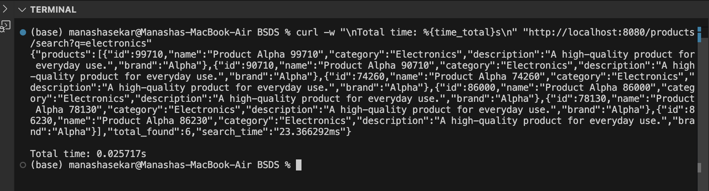
### Single test in AWS
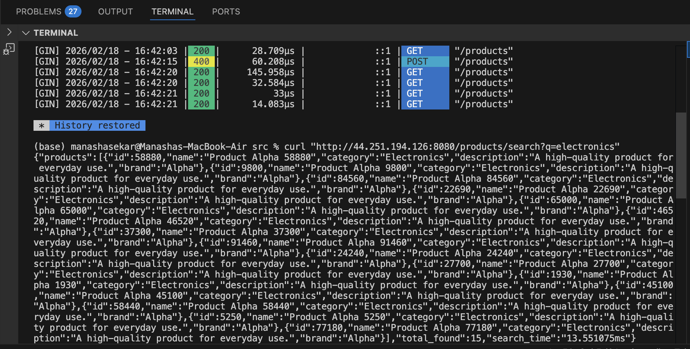

### Test 1: 5 users - 2 minutes
Test 1: 5 users - 2 minutes

- CPU Utilization: ~60%
- Memory Utilization: ~7%
- Avg Response Time:289ms

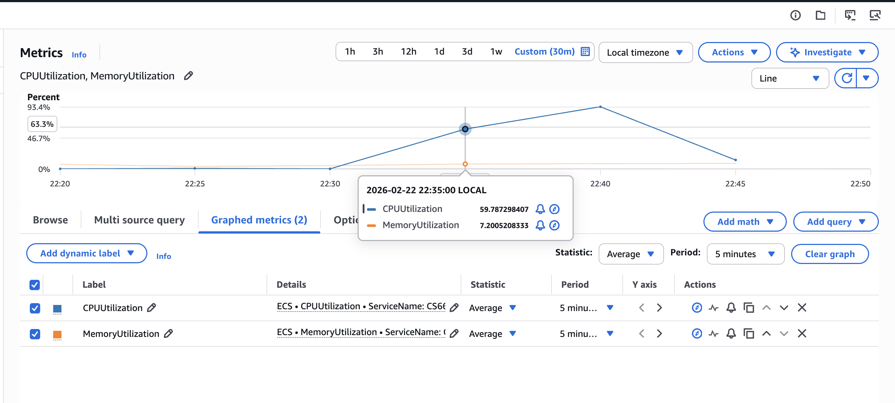

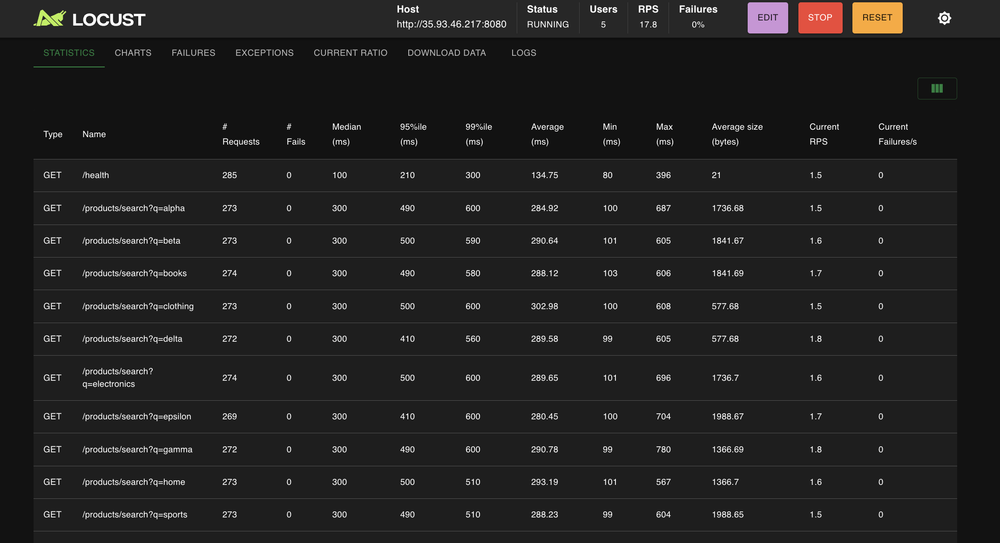

### Test 2: 20 users - 3 minutes
- CPU Utilization: ~94%
- Memory Utilization: ~7% 
- Avg Response Time: 1,104ms

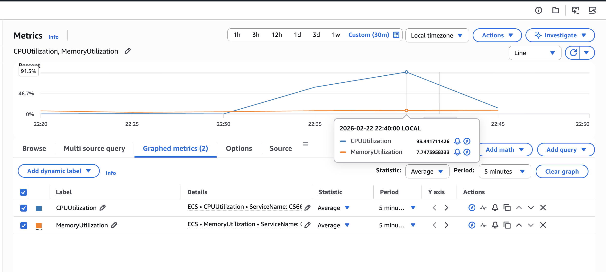

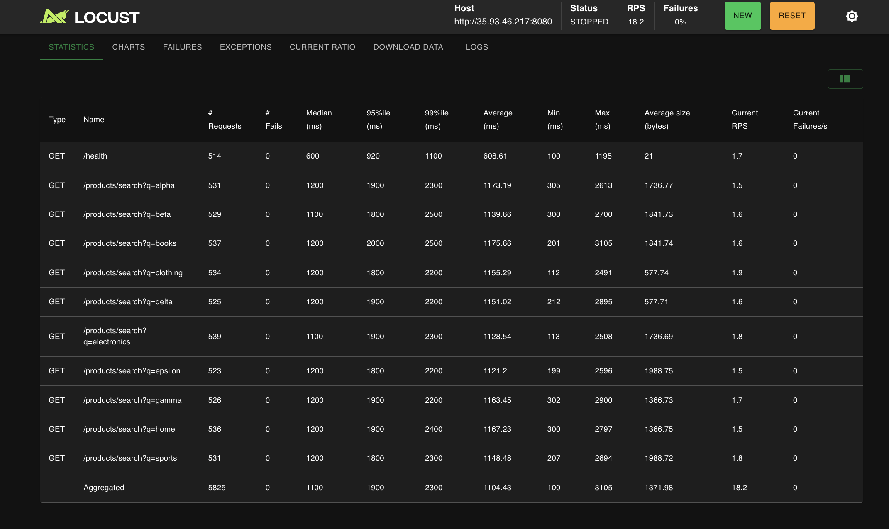

### Analysis
- **Which resource hit the limit first?** CPU — spiked to 93.4%, memory stayed flat at 7.7%.
- **How much did response times degrade?** ~4x worse (289ms → 1,104ms), max went from 780ms → 3,105ms.
- **Could doubling CPU solve this?** Temporarily yes — it would give more headroom, but with more users it would hit the same wall again. Horizontal scaling is the real solution.
---

## Part 3: Horizontal Scaling with Auto Scaling

### Infrastructure Setup
- Application Load Balancer (ALB) distributing requests
- Auto Scaling: Target 70% CPU, min 2 instances, max 4
- Unchanged code

### Component Roles

| Component | Purpose |
|---|---|
| ALB | Distributes incoming requests across healthy instances |
| Target Group | Tracks which instances are healthy (health check on `/health`) |
| Auto Scaling | Adds/removes instances based on CPU utilization |

### Single Test

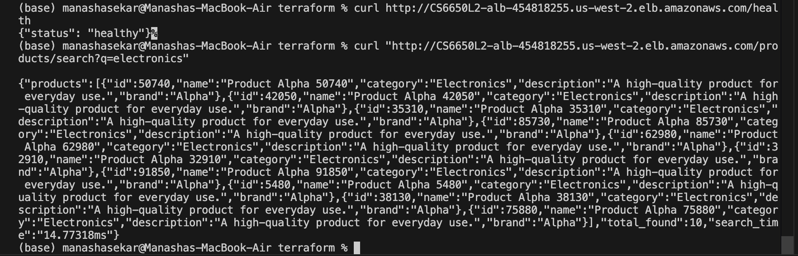

### Load Test: Same Test That Broke Part 2
- Starting instances: 2
- Final instances after scaling: 3
- Avg Response Time: 406ms (vs 1,104ms in Part 2)
- RPS - 50.9 (vs 18.2 in Part 2)

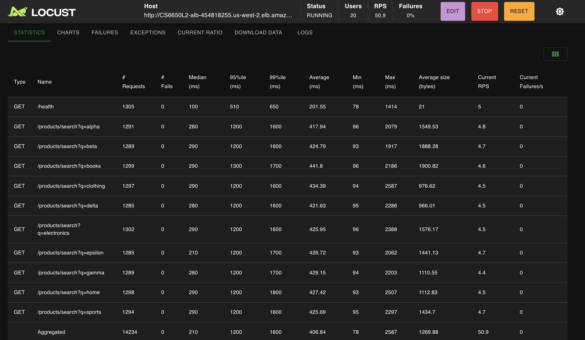

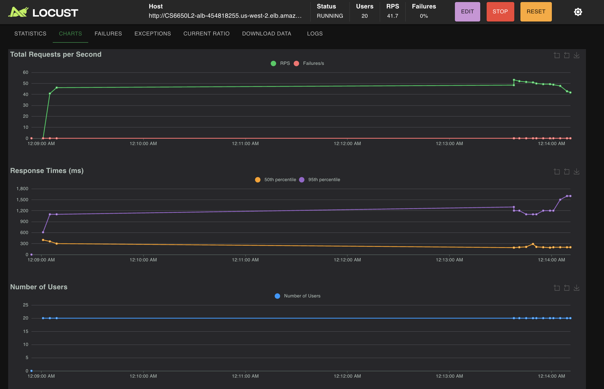

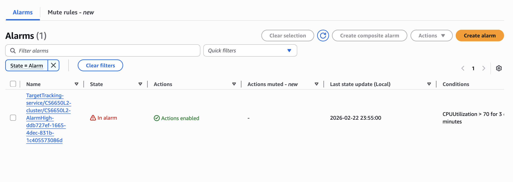

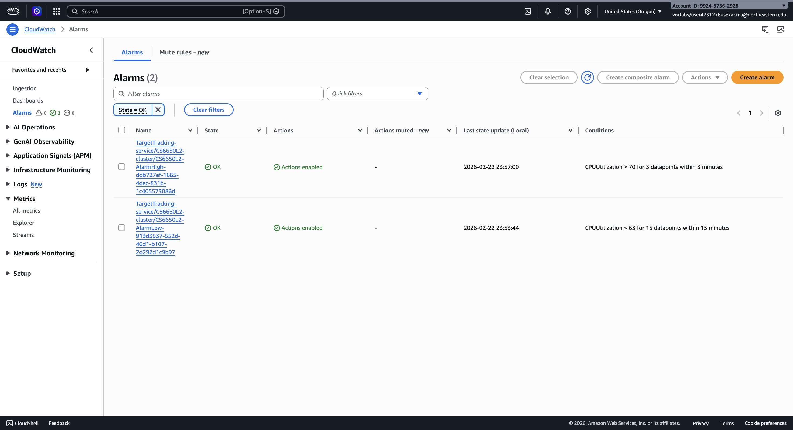

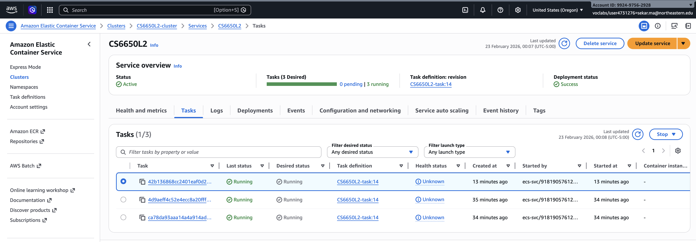

### Resilience Test: Stopping an Instance

- Stopped a task during load test
- Service stayed up: Yes — 0 failures in Locust
- New task spun up automatically: ECS replaced the stopped task
- The ALB detected the unhealthy target and routed traffic to remaining instances.

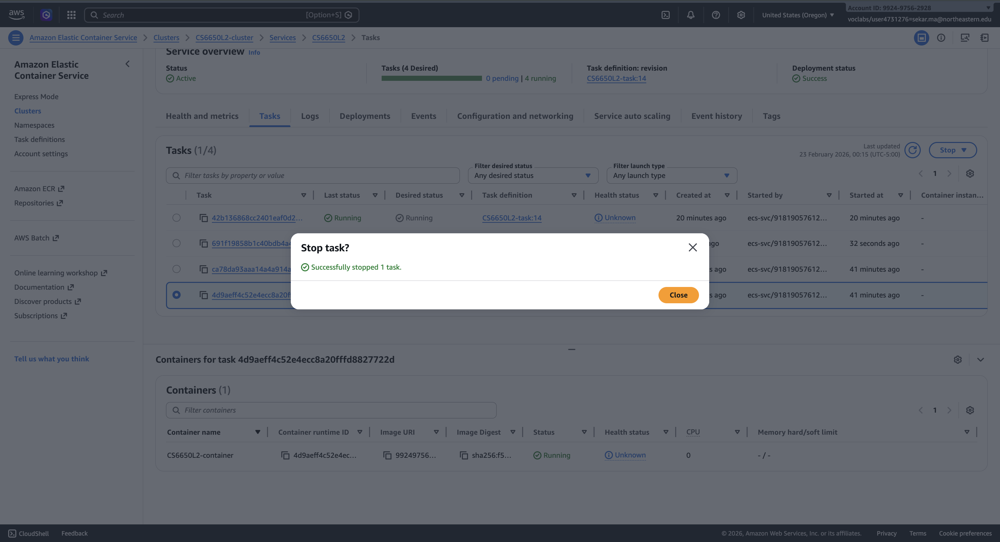

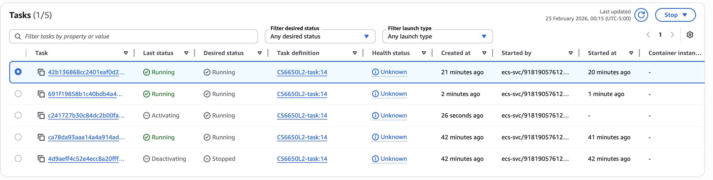
Task Restarting

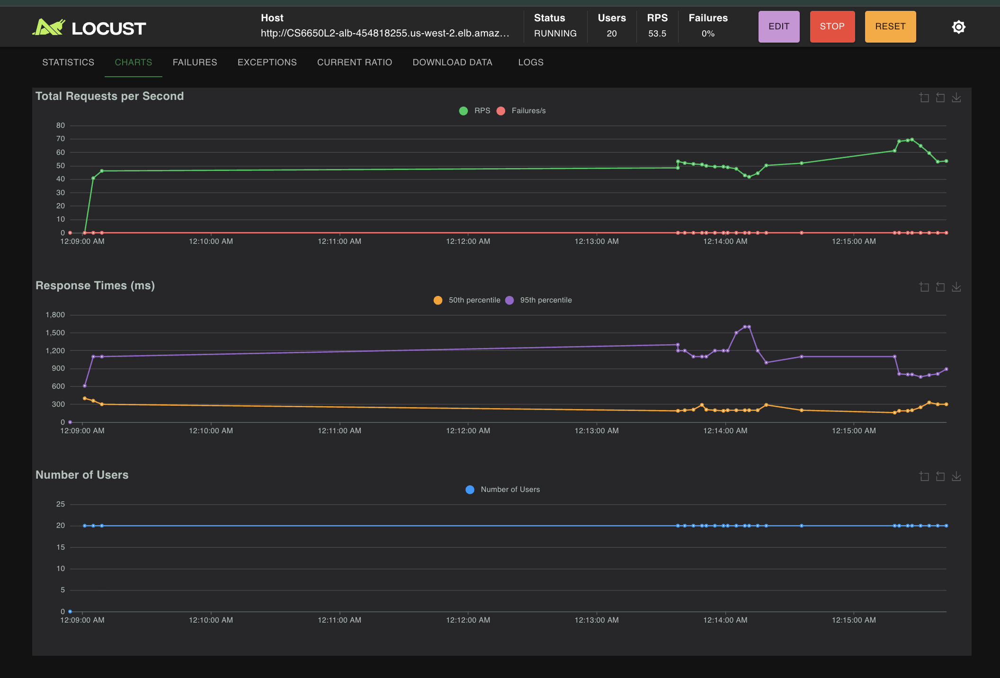
No failure
## Scaling Behavior Predictions (Informed by Experimental Data)

Based on observed results — 20 users scaled to 3 instances (406ms avg), 50 users scaled to 4 instances (710ms avg):

| Scenario | Predicted Behavior |
|---|---|
| **80+ users, sudden spike** | Hits max 4 instances quickly, but 4 instances won't be enough — expect response times >1.5s and potential timeouts. Would need to raise max instance count. |
| **50 users → 5 users (drop-off)** | After 300s scale-in cooldown, instances gradually reduce from 4 back to 2 as CPU drops below 70% target |
| **Periodic bursts (50 users every 10 min)** | 300s cooldown prevents rapid flapping; instances likely stay at 3-4 between bursts rather than scaling down fully |
| **Single instance failure under load** | Confirmed: ALB reroutes traffic, ECS replaces task, 0 failures observed. Brief latency spike but no downtime. |

### Stress Testing: 50 Users

| | Part 2 (1 instance) | Part 3 - 20 users | Part 3 - 50 users |
|---|---|---|---|
| Avg Response | 1,104ms | 406ms | 710ms |
| Median | 1,200ms | 290ms | 290ms |
| RPS | 18.2 | 50.9 | 65.3 |
| Max | 3,105ms | 2,587ms | 7,261ms |
| Failures | 0 | 0 | 0 |

- Even with 50 users, the system handled the load with 0 failures — auto scaling expanded to 4 instances to meet the demand.

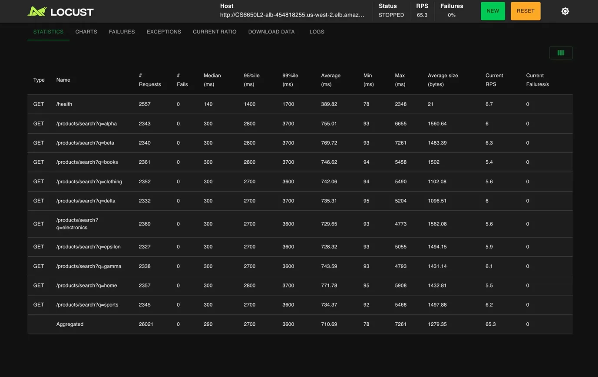
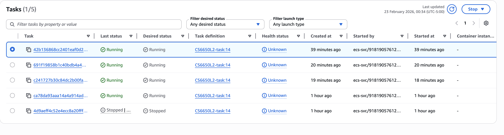

### Vertical vs Horizontal Scaling

| | Vertical Scaling | Horizontal Scaling |
|---|---|---|
| Definition | Bigger machine (more CPU/RAM) | More machines |
| Pros | Simple, no code changes needed | Handles unlimited growth, fault tolerant |
| Cons | Has an upper limit, single point of failure | More complex infrastructure (ALB, auto scaling) |
| Best for | Quick fixes, small workloads | Production systems, high availability |

### Conclusion
- The same 20-user load that degraded Part 2 (1,104ms avg) 
  is handled smoothly with horizontal scaling (406ms avg)
- Response times improved by ~63% and throughput increased nearly 3x
- Auto scaling responded to CPU demand — scaled from 2 to 4 instances 
  when CPU exceeded 70%
- Resilience test proved individual instance failures don't bring 
  down the service — 0 failures when a task was manually stopped
- Even 50 concurrent users were handled with 0 failures
- This is why horizontal scaling is foundational to modern distributed systems