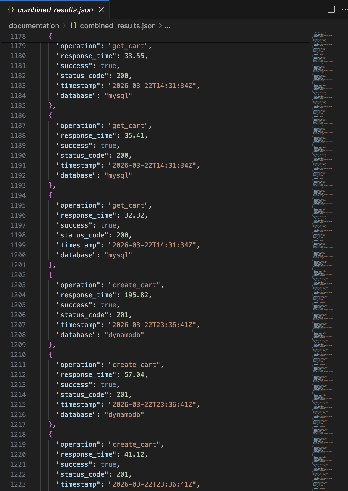
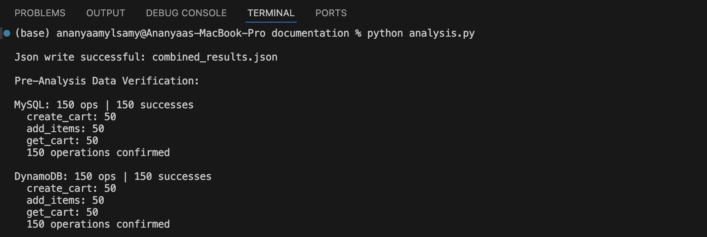
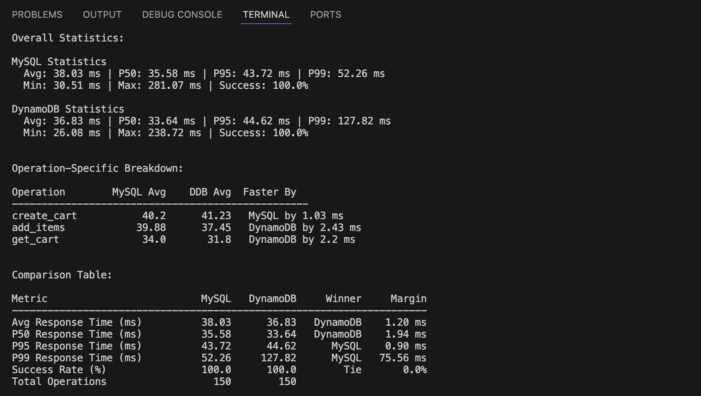

# Step III: Database Comparison & Analysis

## Part 0: Pre-Analysis Data Verification

Both test files were verified using the analysis script before any comparison was performed. Each file contained exactly 150 operations: 50 create_cart, 50 add_items, and 50 get_cart, with a 100% success rate for both databases. The two files were merged into combined_results.json, which served as the single source for all analysis below.
#### combined_results.json

#### Data Verification

## Part 1: Performance Comparison

### Required Comparison Table

| Metric                  | MySQL  | DynamoDB | Winner   | Margin    |
|-------------------------|--------|----------|----------|-----------|
| Avg Response Time (ms)  | 38.03  | 36.83    | DynamoDB | 1.20 ms   |
| P50 Response Time (ms)  | 35.58  | 33.64    | DynamoDB | 1.94 ms   |
| P95 Response Time (ms)  | 43.72  | 44.62    | MySQL    | 0.90 ms   |
| P99 Response Time (ms)  | 52.26  | 127.82   | MySQL    | 75.56 ms  |
| Success Rate (%)        | 100.0  | 100.0    | Tie      | 0.0%      |
| Total Operations        | 150    | 150      |          |           |

### Operation-Specific Breakdown

| Operation   | MySQL Avg (ms) | DynamoDB Avg (ms) | Faster By           |
|-------------|----------------|-------------------|---------------------|
| create_cart | 40.20          | 41.23             | MySQL by 1.03 ms    |
| add_items   | 39.88          | 37.45             | DynamoDB by 2.43 ms |
| get_cart    | 34.00          | 31.80             | DynamoDB by 2.20 ms |

### Consistency Model Impact Assessment

No eventual consistency delays were observed during DynamoDB testing. All 50 get_cart operations executed immediately after the corresponding add_items operations returned the correct updated data. This is consistent with DynamoDB's typical behavior - read-after-write delays are sub-millisecond under normal sequential load and only become observable under high concurrent multi-region writes.

MySQL provides full ACID guarantees. Every committed write is immediately visible to all subsequent reads, with no consistency configuration needed. This is a meaningful operational difference even though it did not manifest as a measurable delay in our test. In a production scenario with concurrent cart modifications from multiple clients, MySQL's strong consistency eliminates an entire class of bugs that DynamoDB applications must handle explicitly via ConsistentRead: true, at the cost of double the read capacity units.

The most telling consistency-related finding is the P99 gap: DynamoDB's P99 of 127.82ms versus MySQL's 52.26ms. This 75.56ms difference at the tail suggests that DynamoDB's read-modify-write pattern for add_items (GetItem + UpdateItem) introduces occasional latency spikes that MySQL's single atomic UPDATE does not.

## Part 2: Resource Efficiency Analysis

### Connection Management

MySQL requires explicit connection pooling. The RDS instance maintained a stable pool of 10 connections throughout the 150-operation test, with CPU utilization at 3.9% and consistent low I/O. One higher-latency outlier was observed on the first request due to connection warm-up. This means MySQL has a fixed resource floor - connections are allocated upfront and must be managed by the application.

DynamoDB is serverless and requires no connection management. The AWS SDK manages HTTP connections internally, and capacity scales automatically in PAY_PER_REQUEST mode. No throttling events were observed during testing (ThrottledRequests = 0), confirming the cart_id UUID partition key distributed load evenly with no hot partitions. The SuccessfulRequestLatency at the DynamoDB service level stayed under 10ms for all operations - the 30–38ms response times seen in the load test reflect network round-trip from ECS, not DynamoDB processing time.

### Scaling Comparison

MySQL scales vertically. Handling more concurrent sessions requires upgrading the RDS instance size or adding read replicas, both of which require planning and incur downtime or cost changes. Schema changes also require migrations, adding operational overhead as the application evolves.

DynamoDB scales horizontally and automatically. Adding millions of carts requires no configuration change - PAY_PER_REQUEST mode absorbs traffic spikes transparently. The schemaless design also means new attributes can be added to cart records without migrations.

---

## Part 3: Real-World Scenario Recommendations

**Scenario A: Startup MVP** (100 users/day, 1 developer, limited budget, quick launch)
**Recommendation: MySQL (RDS Free Tier)**
A single developer benefits from SQL's familiar query model, strong consistency with no extra configuration, and the ability to run ad-hoc queries for debugging. At 100 users/day, there is no scale pressure that would justify DynamoDB's operational model. RDS Free Tier keeps cost near zero. Our test showed both databases perform equivalently at low load, so the tie goes to operational simplicity.

**Scenario B: Growing Business** (10K users/day, 5 developers, moderate budget, feature expansion)
**Recommendation: DynamoDB**
At 10K users/day, the team will face feature requests like customer purchase history and cart analytics. DynamoDB's schemaless design allows schema evolution without migrations. The avg response time advantage (36.83ms vs 38.03ms) and simpler scaling path justify the switch. A GSI on customer_id can be added for history queries without restructuring the table.

**Scenario C: High-Traffic Events** (50K normal, 1M spike users, revenue-critical)
**Recommendation: DynamoDB**
The core advantage here is PAY_PER_REQUEST auto-scaling. MySQL would require pre-provisioning for peak load (expensive at 1M users) or risk connection exhaustion during spikes. Our test showed DynamoDB had zero throttling events and linear latency behavior under load. For a revenue-critical spike event, the ability to absorb traffic without pre-scaling is worth the P99 tail latency trade-off.

**Scenario D: Global Platform** (millions of users, multi-region, 24/7 availability)
**Recommendation: DynamoDB**
DynamoDB Global Tables provide multi-region replication with automatic failover. MySQL multi-region requires custom replication setups with complex failover logic. At this scale, DynamoDB's managed infrastructure eliminates entire categories of operational work. The eventual consistency trade-off becomes the primary engineering concern, mitigated by using ConsistentRead: true on cart reads.

## Part 4: Evidence-Based Architecture Recommendations

### Shopping Cart Winner: DynamoDB

DynamoDB edges out MySQL for shopping carts based on our test data. It is faster on average (36.83ms vs 38.03ms), faster on the two most frequent operations (add_items and get_cart), requires no connection pool management, and scales without configuration changes.

Response time advantage: 1.20ms faster on average; 2.43ms faster on add_items; 2.20ms faster on get_cart

Implementation complexity: DynamoDB was actually harder to implement - it required a workaround for the reserved word items and a manual two-step read-then-write for updating cart items. MySQL handled both cases with a single built-in statement and no workarounds. MySQL was simpler to code.

Tail latency: MySQL's worst-case response time (P99: 52.26ms) was significantly better than DynamoDB's (P99: 127.82ms). In a real app, this means roughly 1 in 100 users would experience a noticeably slower cart update with DynamoDB.

### When to Choose MySQL Instead

MySQL becomes the better choice when the application requires complex queries across cart data - for example, reporting on which products appear most frequently across all carts, or generating customer purchase history reports joining orders, carts, and products. MySQL's multi-table schema with foreign keys also enforces data integrity constraints automatically, which reduces application-level validation logic. For a small team or a data-heavy analytics use case, MySQL's operational familiarity and query flexibility outweigh DynamoDB's scaling advantages.

### Polyglot Strategy for a Complete E-Commerce System

| Component       | Recommendation | Reasoning                                                              |
|-----------------|----------------|------------------------------------------------------------------------|
| Shopping carts  | DynamoDB       | High write volume, simple access by ID, natural session expiration with TTL |
| User sessions   | DynamoDB       | Same pattern as carts - key-value, high volume, TTL useful             |
| Product catalog | MySQL          | Complex queries, filtering, sorting, joins with inventory              |
| Order history   | MySQL          | Relational integrity critical, joins needed across users/products/orders |

---

## Part 5: Learning Reflection

### What Surprised Us

The most counter-intuitive result was DynamoDB's P99 being significantly worse than MySQL's (127.82ms vs 52.26ms) despite DynamoDB winning on average latency. This happened because the add_items operation requires a read-modify-write cycle (GetItem + UpdateItem) to handle quantity upserts, while MySQL handles the same case in a single atomic ON DUPLICATE KEY UPDATE statement. The extra network round-trip to DynamoDB accumulates at the tail.

On the MySQL side, the connection warm-up spike on the first request (visible as a single high-latency outlier in the CloudWatch data) confirmed that connection pool initialization is a real cost, not just a theoretical concern.

### What Failed Initially

DynamoDB had two early failures: a Docker ARM/AMD64 architecture mismatch on Fargate, and an UpdateItem rejection because items is a reserved keyword in DynamoDB, requiring the #itms alias. Neither issue has a MySQL equivalent.

On the MySQL side, an orders table was added early then found to be out of scope. Removing it required a schema migration and code updates - something that in DynamoDB would have been as simple as just stopping use of that attribute.

### Key Insights

Both databases completed all 150 operations with 100% success and sub-50ms average response times. At the scale tested, the performance difference is operationally negligible. The real differentiator is not raw speed but operational model: MySQL requires you to manage connections, schemas, and query complexity; DynamoDB requires you to manage access patterns, consistency, and expression syntax upfront.

The key takeaway from this assignment is that choosing a database is less about which one is faster and more about what kind of queries your application needs to run. Shopping carts have exactly one access pattern (retrieve by ID), which is DynamoDB's strongest use case. Order history and product search have complex access patterns with joins and filters, which is MySQL's strongest use case. A production e-commerce system almost certainly needs both.

## Author
Ananyaa Mylsamy