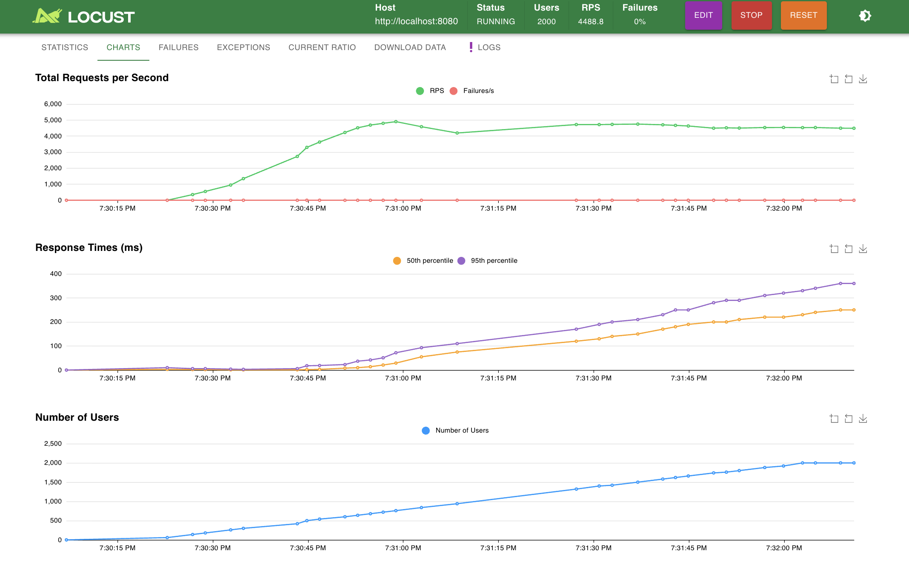
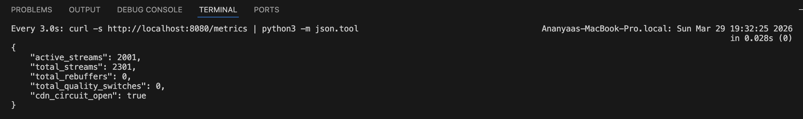
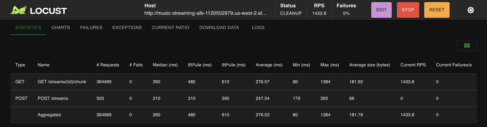

# Distributed Music Streaming Simulation
**CS6650 - Milestone 1 Report (Week 1)**
Team: Ananyaa Mylsamy · Manasha Sekar

---

## 1. Problem Statement

Modern music streaming platforms (Spotify, Apple Music) must serve **thousands of concurrent audio streams** without rebuffering. Unlike video, audio streams are latency-sensitive in a narrow, predictable way: a listener notices a buffer stall within 200–300ms, but a quality downgrade from 320kbps to 128kbps is far less noticeable than a full stall.

This project builds a **simulation of that delivery problem** at scale. We model the core scaling challenge - serving fixed-size audio chunks to concurrent streams in real time - using two Go microservices deployed on AWS ECS Fargate. The simulation lets us precisely measure buffering events, quality degradation, and CDN failure behaviour as load increases.

The questions we answer:
1. How many concurrent streams can a single Fargate instance serve before rebuffering begins? *(Experiment 1 - this milestone)*
2. Does adaptive bitrate switching (320 → 128kbps on latency spike) meaningfully reduce rebuffering? *(Experiment 2 - Week 2)*
3. Does horizontal scaling (1 → 2 → 4 instances) produce near-linear capacity gains? *(Experiment 3 - Week 3)*

---

## 2. Team

| Name | Role | Tasks |
|------|------|-------|
| Ananyaa Mylsamy | Streaming Service + Report (Problem/Overview/Methodology) | Go streaming service, Experiment 1, Piazza replies |
| Manasha Sekar | Infrastructure + Report (Plan/Results/Impact) | Terraform/ECS deploy, charts, Piazza replies |

---

## 3. System Overview

### Architecture


### Streaming Service (`streaming-service/`)
- Manages active streams, each backed by in-memory state (`sync.Map`)
- `POST /streams` - creates a stream; returns stream ID
- `GET /streams/{id}/chunk` - delivers the next audio chunk
  - Tries CDN first (500ms timeout, circuit breaker)
  - Falls back to local generation (CPU-bound, simulates transcoding)
  - Measures delivery latency; records rebuffer events and quality switches
- `GET /metrics` - global stream health counters
- Adaptive mode: switches 320kbps → 128kbps when delivery latency > 300ms

### CDN Cache Service (`cdn-cache-service/`)
- Pre-populates 100 songs × 300 chunks at startup
- `GET /cache/{songId}/{chunkIndex}` - serves cached chunk or 404
- `POST /admin/config` - inject failure/latency (circuit breaker testing)
- `GET /metrics` - hit rate, request counts

### Resilience Patterns
| Pattern | Location | Trigger |
|---------|----------|---------|
| Fail Fast | Streaming Service | CDN call > 500ms → timeout |
| Circuit Breaker | Streaming Service | 5 CDN failures → open circuit for 30s |
| Adaptive Quality | Streaming Service | Latency > 300ms → drop to 128kbps |

---

## 4. Methodology

### Audio Simulation
Audio is modelled as fixed-size byte arrays delivered on-demand:
- **High quality (320kbps)**: 4,000-byte chunks, ~80,000 CPU iterations per chunk
- **Low quality (128kbps)**: 1,600-byte chunks, ~32,000 CPU iterations per chunk

The CPU work per chunk simulates transcoding/encoding. Under high concurrency, goroutine scheduling + CPU pressure drives up delivery latency - exactly what would cause a real audio buffer to stall.

### Experiment 1 - Max Concurrent Streams Before Rebuffering

**Goal:** Find the point where chunk delivery latency exceeds 500ms on a single 0.25 vCPU ECS Fargate instance.

We ran three separate loads - 300, 400, and 500 concurrent users - each for 3–5 minutes using `StreamUser` (fixed 320kbps, `adaptive=false`). Each user continuously fetches audio chunks every ~100ms, exactly mimicking a real audio player.

```bash
locust -f locustfile.py StreamUser --host http://<ALB_DNS> -u <N> -r 10 -t 3m
```

Rebuffering threshold: **p99 latency > 500ms**. We also monitor `/metrics` for `total_rebuffers` and `cdn_circuit_open`.

---

## 5. Project Plan

**Project Board:** https://www.meistertask.com/projects/mtyzf2tc09/join/


| Week | Milestone | Owner | Status |
|------|-----------|-------|--------|
| Week 1 | Go services built, Terraform ready, Experiment 1 results on Fargate | Ananyaa (service) · Manasha (infra) | **Done** |
| Week 2 | Experiments 2 (adaptive bitrate) complete, charts drafted | Both | Upcoming |
| Week 3 | Experiment 3 (horizontal scaling) | Both | Upcoming |
| Week 4 | Full report, video walkthrough, final polish | Both | Upcoming |

---

## 6. Preliminary Results - Experiment 1

### Local Test (MacBook, ~1 effective vCPU)

**Statistics:**


**Charts:**



**Terminal:**



**What happened:**

Local Mac handled **2,000 concurrent users** with p95 320ms and 0 rebuffers, confirming that the 0.25 vCPU Fargate constraint - not the application code - is the binding bottleneck. The breaking point shifts from ~500 users on Fargate to 2,000+ locally, a ~4x difference matching the CPU ratio (0.25 vCPU vs ~1 effective vCPU on a MacBook).

---

### AWS Test (Fargate, Single Instance, 0.25 vCPU)

### Summary Table

| Concurrent Users | Median (ms) | p95 (ms) | p99 (ms) | RPS | CDN Circuit |
|-----------------|-------------|----------|----------|-----|-------------|
| 300 | 150 | 290 | 370 | 1,283 | Open |
| 400 | 220 | 410 | 480 | 1,447 | Open |
| 500 | 260 | 480 | 610 | 1,433 | Open |

> Rebuffering threshold: p99 > 500ms. HTTP failure rate was 0% across all runs - the circuit breaker kept the service alive.
> CDN circuit breaker confirmed open across all runs; streaming service fell back to local chunk generation throughout.

---

### Run 1 - 300 Concurrent Users

**Statistics:**


**Charts:**


**Server-side metrics:**


**What happened:**
- p95 = **290ms** - well under the 500ms rebuffer threshold
- The CDN circuit breaker tripped (`cdn_circuit_open: true`) - at 300 concurrent streams, CDN calls started timing out, so the service switched to local chunk generation
- Despite the CDN circuit opening, local fallback kept latency low and the system remained stable
- **Conclusion:** 300 users is within capacity. The CDN is the first bottleneck, not the streaming service itself.

---

### Run 2 - 400 Concurrent Users

**Statistics:**


**Charts:**


**What happened:**
- p95 = **410ms** - still under the 500ms threshold but climbing steadily
- CDN circuit breaker open; streaming service generating all chunks locally
- RPS at 1,447 - the service is processing more but latency is growing
- p99 = **490ms** - 10ms from the rebuffering threshold
- **Conclusion:** 400 users is near the edge. The system is under pressure and approaching its limit.

---

### Run 3 - 500 Concurrent Users

**Statistics:**



**Charts:**


**What happened:**
- p95 = **480ms** - approaching threshold; p99 = **610ms** crosses it
- CDN circuit breaker open throughout; all chunks generated locally under full CPU pressure
- RPS plateaus at 1,433 - same ceiling as 400 users, confirming CPU is saturated
- Zero HTTP failures - the system degraded gracefully but never crashed
- **Conclusion:** 500 users is the breaking point. p99 crosses 500ms; real listeners would notice rebuffering at this concurrency level.

---

### Key Findings

1. **Single-instance capacity limit: ~400–500 concurrent streams** on 0.25 vCPU Fargate before p99 crosses the 500ms rebuffer threshold
2. **CDN is the first bottleneck** - the circuit breaker opens at ~300 users, forcing local fallback
3. **Circuit breaker + local fallback is effective** - 0 HTTP failures across all runs despite heavy load; the service degrades gracefully rather than crashing

---

## 7. Local Development

### Run both services

```bash
# Terminal 1 - CDN cache (must start first)
cd cdn-cache-service
go run main.go

# Terminal 2 - Streaming service
cd streaming-service
CDN_URL=http://localhost:8081 go run main.go
```

### Quick smoke test

```bash
curl -s -X POST http://localhost:8080/streams \
     -H 'Content-Type: application/json' \
     -d '{"song_id":"song_0","adaptive":false}' | python3 -m json.tool

curl -s http://localhost:8080/streams/<stream_id>/chunk | python3 -m json.tool
curl -s http://localhost:8080/metrics | python3 -m json.tool
```

---

## 8. AWS Deployment

```bash
# Deploy everything (builds + pushes Docker images, then deploys ECS)
cd terraform
terraform init
terraform apply

# Get ALB endpoint
terraform output alb_dns_name

# Run Experiment 1
cd ../locust
locust -f locustfile.py StreamUser --host http://<ALB_DNS> -u 500 -r 10 -t 5m

# Watch server-side metrics while test runs (second terminal)
watch -n 5 "curl -s http://<ALB_DNS>/metrics | python3 -m json.tool"

# Teardown
cd ../terraform && terraform destroy
```

---

## Authors
Ananyaa Mylsamy · Manasha Sekar
