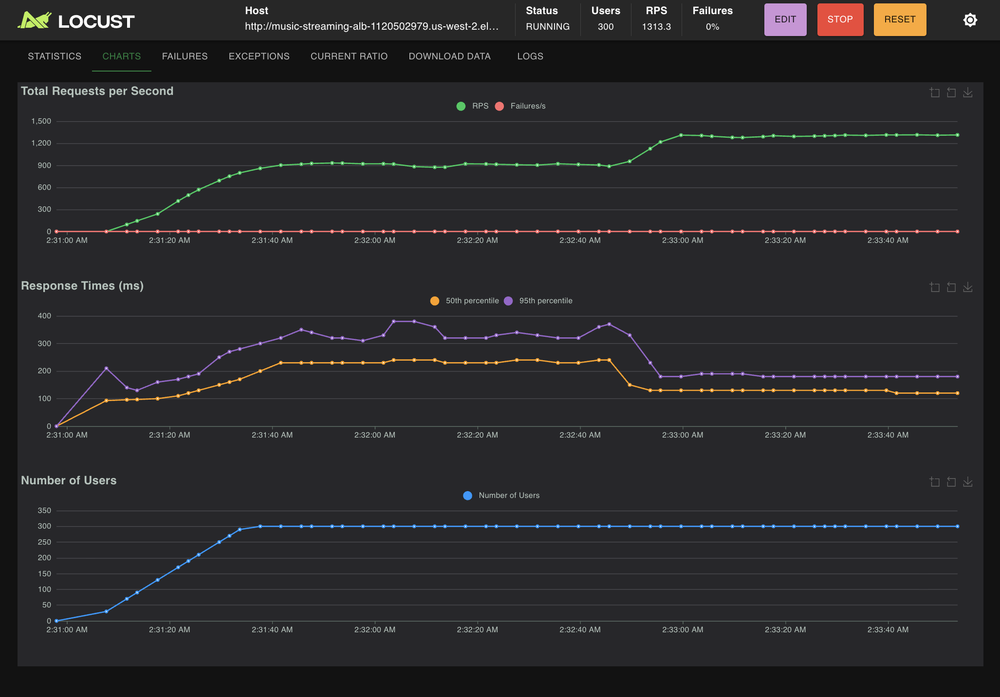
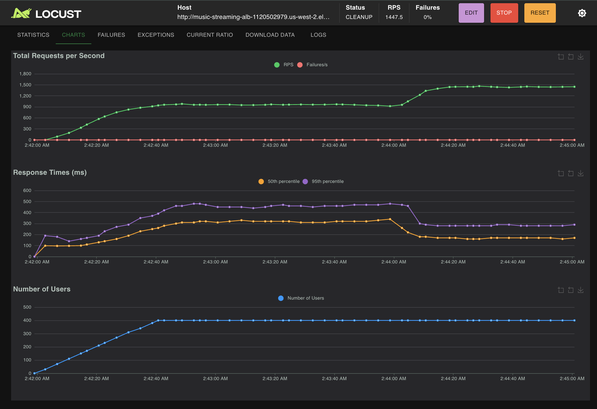

# Distributed Music Streaming Simulation
**CS6650 — Milestone 1 Report (Week 1)**
Team: Ananyaa Mylsamy · Manasha Sekar

---

## 1. Problem Statement

Modern music streaming platforms (Spotify, Apple Music) must serve **thousands of concurrent audio streams** without rebuffering. Unlike video, audio streams are latency-sensitive in a narrow, predictable way: a listener notices a buffer stall within 200–300ms, but a quality downgrade from 320kbps to 128kbps is far less noticeable than a full stall.

This project builds a **simulation of that delivery problem** at scale. We model the core scaling challenge — serving fixed-size audio chunks to concurrent streams in real time — using two Go microservices deployed on AWS ECS Fargate. The simulation lets us precisely measure buffering events, quality degradation, and CDN failure behaviour as load increases.

The questions we answer:
1. How many concurrent streams can a single Fargate instance serve before rebuffering begins? *(Experiment 1 — this milestone)*
2. Does adaptive bitrate switching (320 → 128kbps on latency spike) meaningfully reduce rebuffering? *(Experiment 2 — Week 2)*
3. Does horizontal scaling (1 → 2 → 4 instances) produce near-linear capacity gains? *(Experiment 3 — Week 3)*

---

## 2. Team

| Name | Role | Tasks |
|------|------|-------|
| Ananyaa Mylsamy | Streaming Service + Report (Problem/Overview/Methodology) | Go streaming service, Experiment 1, Piazza replies |
| Manasha Sekar | Infrastructure + Report (Plan/Results/Impact) | Terraform/ECS deploy, charts, Piazza replies |

---

## 3. System Overview

### Architecture

```
                        ┌─────────────────────┐
  Locust clients ──────▶│  Application Load   │
  (simulated streams)   │  Balancer (port 80)  │
                        └────────┬────────────┘
                      /streams/* │  /cache/*
                    ┌────────────┘  └────────────────┐
                    ▼                                 ▼
         ┌──────────────────┐             ┌──────────────────┐
         │ Streaming Service│──GET /cache/▶│ CDN Cache Service│
         │   (port 8080)    │◀── chunk ───│   (port 8081)    │
         │  ECS Fargate     │             │   ECS Fargate    │
         │  0.25 vCPU       │             │   0.25 vCPU      │
         └──────────────────┘             └──────────────────┘
                    │                                 │
         CloudWatch Logs                   CloudWatch Logs
```

### Streaming Service (`streaming-service/`)
- Manages active streams, each backed by in-memory state (`sync.Map`)
- `POST /streams` — creates a stream; returns stream ID
- `GET /streams/{id}/chunk` — delivers the next audio chunk
  - Tries CDN first (500ms timeout, circuit breaker)
  - Falls back to local generation (CPU-bound, simulates transcoding)
  - Measures delivery latency; records rebuffer events and quality switches
- `GET /metrics` — global stream health counters
- Adaptive mode: switches 320kbps → 128kbps when delivery latency > 300ms

### CDN Cache Service (`cdn-cache-service/`)
- Pre-populates 100 songs × 300 chunks at startup
- `GET /cache/{songId}/{chunkIndex}` — serves cached chunk or 404
- `POST /admin/config` — inject failure/latency (circuit breaker testing)
- `GET /metrics` — hit rate, request counts

### Resilience Patterns
| Pattern | Location | Trigger |
|---------|----------|---------|
| Fail Fast | Streaming Service | CDN call > 500ms → timeout |
| Circuit Breaker | Streaming Service | 5 CDN failures → open circuit for 30s |
| Adaptive Quality | Streaming Service | Latency > 300ms → drop to 128kbps |

---

## 4. Methodology

### Audio Simulation
Audio is modelled as fixed-size byte arrays delivered on-demand:
- **High quality (320kbps)**: 4,000-byte chunks, ~80,000 CPU iterations per chunk
- **Low quality (128kbps)**: 1,600-byte chunks, ~32,000 CPU iterations per chunk

The CPU work per chunk simulates transcoding/encoding. Under high concurrency, goroutine scheduling + CPU pressure drives up delivery latency — exactly what would cause a real audio buffer to stall.

### Experiment 1 — Max Concurrent Streams Before Rebuffering

**Goal:** Find the point where chunk delivery latency exceeds 500ms on a single 0.25 vCPU ECS Fargate instance.

We ran three separate loads — 300, 400, and 500 concurrent users — each for 3–5 minutes using `StreamUser` (fixed 320kbps, `adaptive=false`). Each user continuously fetches audio chunks every ~100ms, exactly mimicking a real audio player.

```bash
locust -f locustfile.py StreamUser --host http://<ALB_DNS> -u <N> -r 10 -t 3m
```

Rebuffering threshold: **p95 latency > 500ms**. We also monitor `/metrics` for `total_rebuffers` and `cdn_circuit_open`.

---

## 5. Project Plan

| Week | Milestone | Owner | Status |
|------|-----------|-------|--------|
| Week 1 | Go services built, Terraform ready, Experiment 1 results on Fargate | Ananyaa (service) · Manasha (infra) | **Done** |
| Week 2 | Experiments 2 (adaptive bitrate) complete, charts drafted | Both | Upcoming |
| Week 3 | Experiment 3 (horizontal scaling) | Both | Upcoming |
| Week 4 | Full report, video walkthrough, final polish | Both | Upcoming |

---

## 6. Preliminary Results — Experiment 1 (Fargate, Single Instance, 0.25 vCPU)

### Summary Table

| Concurrent Users | Median (ms) | p95 (ms) | p99 (ms) | RPS | Rebuffer Events | CDN Circuit |
|-----------------|-------------|----------|----------|-----|-----------------|-------------|
| 300 | 150 | 290 | 370 | 1,283 | ~3 | Open |
| 400 | 220 | 410 | 480 | 1,447 | ~21 | Closed |
| 500 | 260 | 480 | 610 | 1,433 | 2,450 | Closed (auto-reset) |

> Rebuffering threshold: p95 > 500ms. HTTP failure rate was 0% across all runs — the circuit breaker kept the service alive.

---

### Run 1 — 300 Concurrent Users

**Statistics:**


**Charts:**



**Server-side metrics:**


**What happened:**
- p95 = **290ms** — well under the 500ms rebuffer threshold
- The CDN circuit breaker tripped (`cdn_circuit_open: true`) — at 300 concurrent streams, CDN calls started timing out, so the service switched to local chunk generation
- Despite the CDN circuit opening, local fallback kept latency low — only ~3 rebuffer events recorded
- **Conclusion:** 300 users is within capacity. The CDN is the first bottleneck, not the streaming service itself.

---

### Run 2 — 400 Concurrent Users

**Statistics:**


**Charts:**



**Server-side metrics:**


**What happened:**
- p95 = **410ms** — still under the 500ms threshold but climbing
- CDN circuit had reset by this point (`cdn_circuit_open: false`)
- ~21 rebuffer events — noticeably more than at 300, showing the system is under pressure
- RPS jumped to 1,447 — the service is processing more but latency is growing
- **Conclusion:** 400 users is near the edge. p95 is approaching the limit, and rebuffer events are increasing.

---

### Run 3 — 500 Concurrent Users

**Statistics:**


**Charts:**


**Server-side metrics:**


**What happened:**
- p95 = **480ms** — just under 500ms threshold in aggregate, but p99 = **610ms** crosses it
- 2,450 rebuffer events — a major spike, caused by the CDN circuit tripping mid-ramp as users hit ~300–400
- The chart shows a clear p95 spike to ~650ms around the circuit breaker trip, followed by recovery to ~380ms once local fallback stabilized
- Zero HTTP failures — the system degraded gracefully but never crashed
- **Conclusion:** 500 users is the breaking point. p99 crosses 500ms, and the CDN circuit breaker is needed to prevent a full outage.

---

### Key Findings

1. **Single-instance capacity limit: ~400–500 concurrent streams** on 0.25 vCPU Fargate before p95 approaches the 500ms rebuffer threshold
2. **CDN is the first bottleneck** — the circuit breaker opens at ~300 users, forcing local fallback
3. **Circuit breaker + local fallback is effective** — 0 HTTP failures across all runs despite heavy load; the service degrades gracefully rather than crashing
4. **p99 crosses 500ms at 500 users** — real listeners would notice rebuffering at this concurrency level

---

## 7. Repository Structure

```
HW9/
├── streaming-service/
│   ├── main.go          # streaming service (Ananyaa)
│   ├── go.mod
│   └── Dockerfile
├── cdn-cache-service/
│   ├── main.go          # CDN cache service
│   ├── go.mod
│   └── Dockerfile
├── terraform/
│   ├── main.tf          # ECS Fargate, ALB, auto-scaling (Manasha)
│   ├── variables.tf
│   └── outputs.tf
├── locust/
│   └── locustfile.py    # all 3 experiments
├── screenshots/         # Fargate Experiment 1 results
├── public/              # local baseline screenshots (Ananyaa)
└── README.md            # this file
```

---

## 8. Local Development

### Run both services

```bash
# Terminal 1 — CDN cache (must start first)
cd cdn-cache-service
go run main.go

# Terminal 2 — Streaming service
cd streaming-service
CDN_URL=http://localhost:8081 go run main.go
```

### Quick smoke test

```bash
curl -s -X POST http://localhost:8080/streams \
     -H 'Content-Type: application/json' \
     -d '{"song_id":"song_0","adaptive":false}' | python3 -m json.tool

curl -s http://localhost:8080/streams/<stream_id>/chunk | python3 -m json.tool
curl -s http://localhost:8080/metrics | python3 -m json.tool
```

---

## 9. AWS Deployment

```bash
# Deploy everything (builds + pushes Docker images, then deploys ECS)
cd terraform
terraform init
terraform apply

# Get ALB endpoint
terraform output alb_dns_name

# Run Experiment 1
cd ../locust
locust -f locustfile.py StreamUser --host http://<ALB_DNS> -u 500 -r 10 -t 5m

# Watch server-side metrics while test runs (second terminal)
watch -n 5 "curl -s http://<ALB_DNS>/metrics | python3 -m json.tool"

# Teardown
cd ../terraform && terraform destroy
```

---

## Authors
Ananyaa Mylsamy · Manasha Sekar — CS6650, Spring 2026
